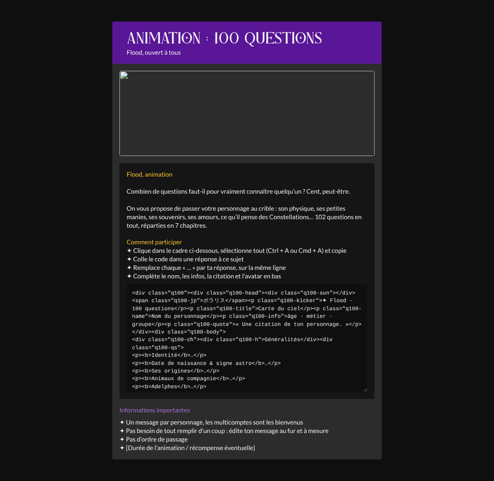
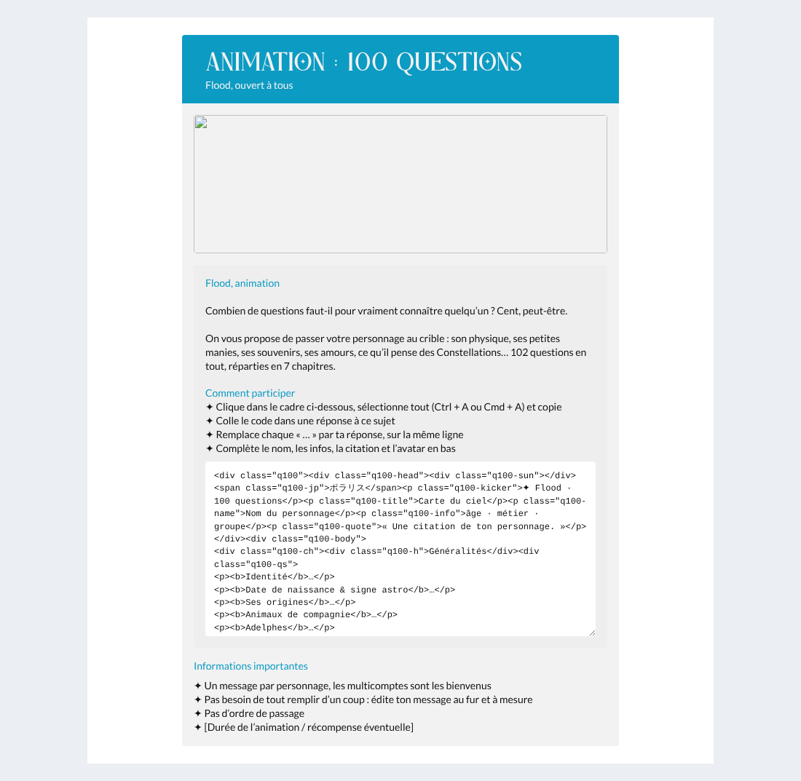

# Animation flood : 100 questions

Code de réponse à copier-coller dans le sujet d'animation du **Flood**, pour que chaque membre
réponde aux questions sur son personnage (liste reprise de la page Notion *100 questions* :
7 chapitres, 102 questions).

## La réponse : « Carte du ciel »

Chaque chapitre est une constellation : les questions sont des étoiles ✦ reliées par un trait
pointillé, numérotées toutes seules de 001 à 102 (compteurs CSS), sur un fond semé de points.
Un grand chiffre romain en contour marque chaque chapitre. En tête, le bandeau du forum
(violet la nuit, cyan le jour) avec un soleil qui tourne lentement (40 s par tour, arrêté si
l'utilisateur a demandé moins d'animations), ポラリス à la verticale et le nom du personnage.
Deux colonnes sur ordinateur, une sur mobile.

| Nuit | Jour | Mobile |
|---|---|---|
|  |  |  |

### Mode d'emploi pour les membres

1. Copier tout le contenu de [`code-reponse.html`](code-reponse.html) et le coller dans une réponse.
2. Remplacer `Nom du personnage`, `âge · métier · groupe`, la citation, chaque `…` après une
   question (sur la même ligne, entre `</b>` et `
`) et `Avatar : …` en bas.
3. Une ligne du code = une question : ne pas ajouter de ligne vide entre deux questions.
   Un retour à la ligne **dans** une réponse est gardé.
4. Ne pas toucher à la balise `<style>` à la fin.

### Notes techniques (Forumactif)

- Tout le style est dans la balise `<style>` en fin de code, préfixé `.q100`. Le mode nuit suit
  `[data-theme=dark]` du forum. Polices *motesar* et *Lato* : déjà chargées par le forum.
- Le `<style>` tient sur **une seule ligne** : Forumactif change chaque retour à la ligne en
  ` `, ce qui casserait le CSS. Pour la même raison, le CSS masque les ` ` placés entre
  les blocs (`.q100 br{display:none}`) et ne les garde que dans les réponses.
- Le script du forum (`String.f2p`) remplace `[b]`, `[i]`, `[u]`, `[s]` et `[tw]` : le CSS n'en
  contient pas (le script le vérifie).
- Testé avec les vrais scripts du forum (`library` + `components`) en jour, en nuit et sur mobile.

## Message d'annonce (staff)

[`annonce.html`](annonce.html) : premier message du sujet (composant `<x-post-admin>` des sujets
d'event), à poster après avoir remplacé `LIEN_IMAGE_NUIT` / `LIEN_IMAGE_JOUR` (bandeau
600 × 190, une version par thème) et la ligne `[Durée de l’animation / récompense éventuelle]`.
Il explique l'animation et contient le code de réponse dans un cadre à copier.

| Nuit | Jour |
|---|---|
|  |  |

⚠️ **Ne pas mettre le code de réponse dans un `[code]`** : le script du forum transforme le texte
du `[code]` en vrai HTML avant d'en faire un cadre à copier, et les membres copieraient le rendu.
L'annonce utilise donc un `<textarea>` écrit sur **une seule ligne**, avec `&#13;` pour les retours
à la ligne : testé avec les scripts du forum, le texte copié est identique à `code-reponse.html`.
Penser à **prévisualiser** avant de poster, au cas où Forumactif filtrerait le `<textarea>`.

## Modifier

Éditer [`generer.py`](generer.py) (questions, CSS, textes), puis
`python3 generer.py > code-reponse.html` (régénère aussi `annonce.html`).
