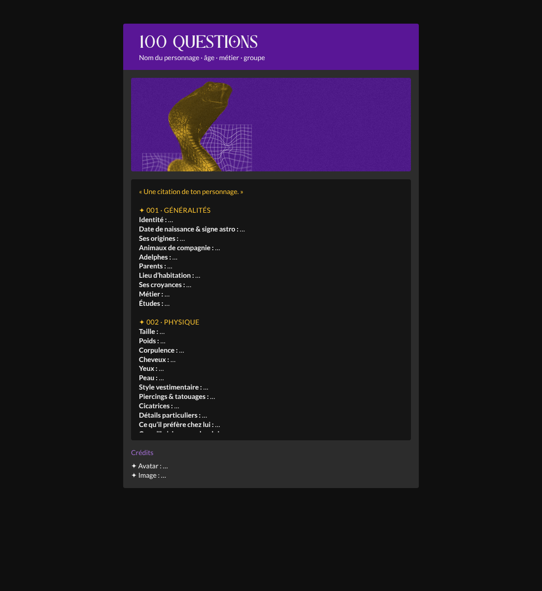
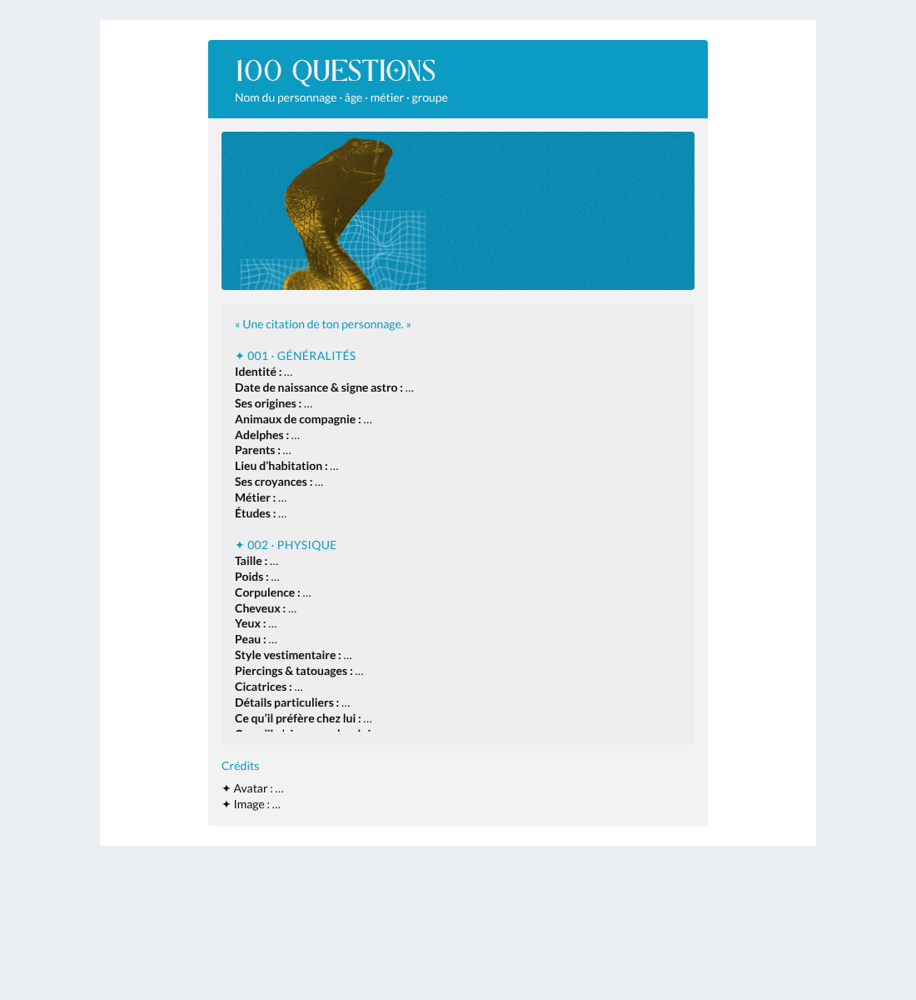

# Animation flood : 100 questions

Code de réponse à copier-coller dans le sujet d'animation du **Flood**, pour que chaque membre
réponde aux questions sur son personnage (liste reprise de la page Notion *100 questions* :
7 chapitres, 102 questions).

Le code utilise le composant du forum **`<x-post-admin>`**, le même que les sujets d'event
(ex. *Évent n° 2 : Attrapez les tous !*) : en-tête violet la nuit et bleu le jour, image,
bloc de texte, note. Le style vient du forum : rien à héberger, et le thème jour / nuit suit tout seul.

| Nuit | Jour | Mobile |
|---|---|---|
|  |  |  |

*(Les aperçus montrent l'image de l'event n° 2 à la place de `LIEN_DE_TON_IMAGE`.)*

## Mode d'emploi pour les membres

1. Copier tout le contenu de [`code-reponse.html`](code-reponse.html) et le coller dans une réponse.
2. Remplacer :
   - `Nom du personnage · âge · métier · groupe` (sous-titre) ;
   - `LIEN_DE_TON_IMAGE` : une image en bandeau (environ 600 × 190 px). Pas d'image ?
     Supprimer `` : le cadre disparaît ;
   - la citation ;
   - chaque `…` après une question, par ta réponse (sur la même ligne) ;
   - les crédits en bas.
3. Une ligne du code = une ligne affichée : ne pas ajouter de retour à la ligne entre deux questions.

Les questions sont dans une zone qui défile (460 px de haut) pour ne pas allonger le Flood.

## Structure du code

| Zone | Contenu |
|---|---|
| `post:titre` | « 100 questions » |
| `post:sous-titre` | nom et infos du personnage |
| `post:image` | bandeau du membre (ou deux images `hidden dark:block` / `block dark:hidden` pour jour et nuit) |
| `post:texte` | citation, puis les 7 chapitres (`Title:H4` jaune la nuit, bleu le jour) et les questions en gras |
| `post:note` | crédits (titre violet clair la nuit, bleu le jour) |

Pour modifier les questions : éditer [`generer.py`](generer.py), puis `python3 generer.py > code-reponse.html`.
