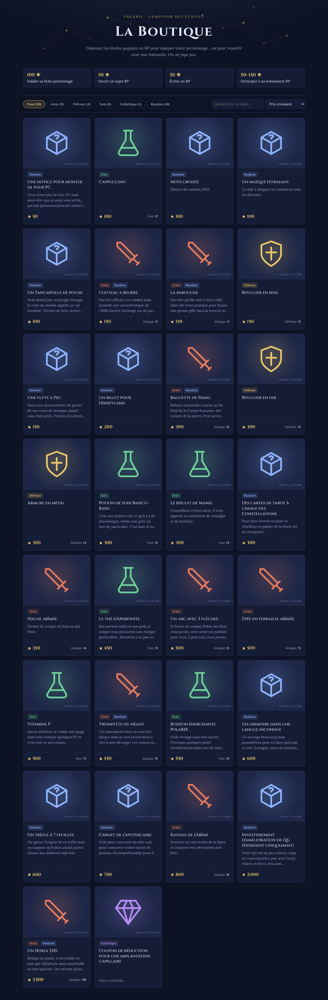
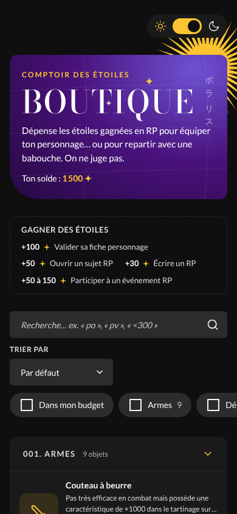

# Boutique Polaris

Page boutique autonome (`boutique.html`) alignée sur le DS Figma *Polaritz* :
variables de couleur, boutons (primaire / secondaire / tertiaire), champs Search et Select,
Tags (filtres à cases), soleils animés. Icônes placeholder en attendant les images des objets.

Fonctionnalités : thème nuit / jour (suit aussi `html.dark` du forum), recherche avec
autocomplétion dès 2 lettres (accents ignorés, mots-clés « pv », « attaque »…, prix « <300 »),
filtres par type à choix multiple, « Dans mon budget », tri, catégories repliables,
panier avec solde restant (colonne à droite sur desktop, barre + feuille du bas sur mobile),
confirmation de commande.

## Intégration Forumactif
Panneau d'admin → Modules → Pages HTML → créer une page et coller `boutique.html`
(ou seulement le `<style>`, le `
…
` et le `<script>` si la page
garde le header du forum).

## À configurer (en haut du `<script>`)
- `SOLDE` : étoiles du membre (valeur de démo : 1 500).
- `ORDER_URL` : sujet où les commandes sont postées.
- `SUN_DARK` / `SUN_LIGHT` : héberger `img/soleil-jaune-300.png` et `img/soleil-noir.png`
  (servimg…) puis remplacer les chemins, ainsi que le `src` de `#plr-sun`.
- `META["Nom de l'objet"]` : reprend les colonnes Notion de la base « Boutique » :
  - `limite` (*Limite d'achat*) : `"multiple"` par défaut (cellule vide), `"personnage"` (1 par personnage),
    `"boutique"` (unique dans toute la boutique, premier arrivé premier servi) ;
  - `grade` (*Grade*) : `Commun`, `Peu commun`, `Rare`, `Épique`, `Légendaire` ;
  - `img` (*Image*) : URL de l'image, qui remplace l'icône placeholder ;
  - `epuise: true` : à mettre quand l'exemplaire unique a été acheté.
  La *Catégorie* Notion correspond aux rayons de la page (Armes, Défense, Soins, Objets random, Esthétique).
- Police des titres : `--plr-font-title` (Bodoni Moda en remplacement de la police du DS).

